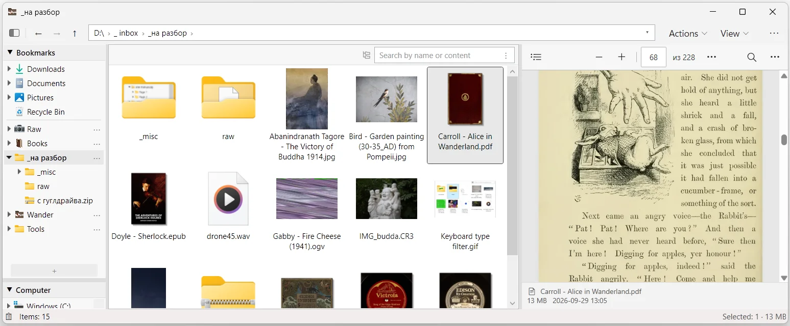

# Wander

🌐 **English** · [Русский](README.ru.md)

**A media manager for Windows 10 and 11** - a file manager focused on comfort and media: stable, clear navigation, fast preview and comparison, batch operations, photo culling.

  
  
  

- 🌐 **[Website and guide](https://lekta.github.io/wander/en/)** - what the app can do and how to use it.
- ⬇️ **[Download the latest version](https://github.com/lekta/wander/releases/latest)** - `Wander.exe` under Assets.
- 🛡️ **[Reliability and speed](https://lekta.github.io/wander/en/guide/reliability-and-speed/index.html)** - how it is tested and built.

> ⚠️ **Beta 0.6** - works and is in daily use. Provided as is, without warranty.

## Running

Download `Wander.exe` and run it, no installation needed: a single file with
.NET inside, nothing is registered in the system. Supported OS - **Windows 10
version 2004 (build 19041) or later, or Windows 11**, x64.

- SmartScreen may warn that the file is not signed with a certificate:
  “More info” → “Run anyway”.
- File integrity: the hash of the download is `(Get-FileHash Wander.exe
  -Algorithm SHA256).Hash` in PowerShell. Compare it with `sha256:…` in the
  **`Wander.exe`** row of the release page or with the contents of
  `Wander.exe.sha256`; letter case does not matter. The hash in the
  `Wander.exe.sha256` row is the hash of that text file, not of the program.
- Previews of HTML, Markdown and PDF use the **WebView2 Runtime** - it is
  already part of Windows 11 and an up-to-date Windows 10; if it is missing,
  get the [Evergreen Runtime from Microsoft](https://developer.microsoft.com/microsoft-edge/webview2/).

## License

[PolyForm Noncommercial 1.0.0](LICENSE) © Lekta, 2026. Use, study, change
and share the code freely **for any noncommercial purpose**. Commercial use
only by agreement with the author:
[wander.fleshed218@simplelogin.com](mailto:wander.fleshed218@simplelogin.com).
This is a source-available license (not
OSI open source); the software is provided “as is”, without warranty or
liability.

## Development

Building from source, tests and pull request rules -
[CONTRIBUTING.md](docs/CONTRIBUTING.md); how the code is organized -
[ARCHITECTURE.md](docs/ARCHITECTURE.md); vulnerabilities -
[SECURITY.md](docs/SECURITY.md). The project documentation is in Russian.
